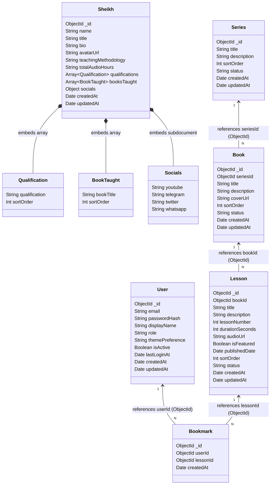
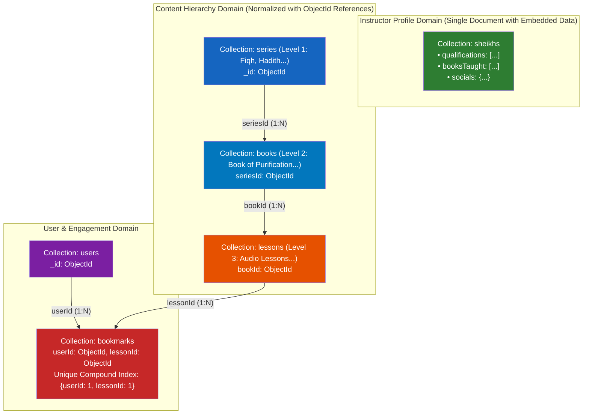

# MongoDB Document Relationship Diagram & Architecture

## MongoDB Document Reference & Embedding Diagram

The diagram below depicts the MongoDB document models, embedded subdocuments, and normalized `ObjectId` references.

---

## Simplified MongoDB Collection Architecture

